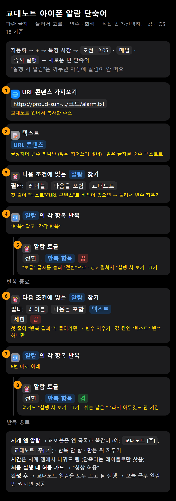

# 아이폰 시계 알람 연동 (단축어)

아이폰 웹앱(PWA)은 정해진 시각에 알람을 울릴 수 없습니다.
그래서 교대노트가 **앞으로 1년 동안 "그날 켤 알람 이름"**을 서버에 올려두고,
아이폰 **단축어 자동화**가 매일 00:05에 "오늘 켤 알람 이름"을 받아 **시계 앱 알람**을 켜고 끕니다.
시계 앱 알람이라 무음 모드에서도 울리고, 다시 알림(스누즈)도 됩니다.

## 1. 교대노트에서 연동 켜기

1. 설정 → **알람 설정 (근무 시작 기준)** 카드를 눌러 펼치고, 근무별 알람 시간·재알림 횟수를 정해 켭니다.
2. 같은 카드 맨 아래 **📱 아이폰 시계 알람 연동** → **아이폰 알람 연동 켜기**를 누릅니다.
3. 나오는 **주소를 복사**합니다. (단축어에 넣을 주소, `…/alarm.txt`로 끝남)
4. 그 아래 **시계 앱에 미리 만들어 둘 알람** 목록을 확인합니다. 예 (주간 05:30, 재알림 2회):
   - `교대노트 [주]` — 05:30
   - `교대노트 [주] 2` — 05:33

## 2. 시계 앱에 알람 만들기

시계 앱 → 알람 → `+` 로 위 목록대로 알람을 만듭니다.

- **레이블**을 목록과 글자 하나 틀리지 않게 똑같이 입력합니다. 대괄호 `[ ]`와 띄어쓰기까지 같아야 합니다(대괄호는 키보드 **123 → #+=**).
  - `교대노트`만 쓰면 안 됩니다. `[주]`, `[야]`가 있어야 그날 근무 알람만 골라 켤 수 있습니다.
- **반복: 안 함**으로 둡니다. (교대노트의 "재알림 횟수"와는 다른 설정입니다. 재알림은 `교대노트 [주] 2`처럼 3분 간격 알람을 따로 만들어 대신합니다)
- 만든 뒤에는 **꺼둡니다.** 켜고 끄는 건 단축어가 합니다.
- **시간은 시계 앱에서 바꿔도 됩니다.** 단축어는 레이블로만 찾습니다. 다만 안드로이드·앱 목록과 맞추려면 교대노트의 알람 시간도 같이 바꾸세요.
- 사운드, 다시 알림(스누즈)은 원하는 대로 설정합니다.

## 3. 단축어 자동화 만들기 (8단계, 조건문 없음)

단축어 앱 → **자동화** → `+` → **특정 시간** → `오전 12:05`, **매일**, **즉시 실행** → **새로운 빈 단축어**

매일 **교대노트 알람을 전부 끈 다음, 오늘 알람만 켭니다.** 전날 상태와 관계없이 매번 정확히 맞춰집니다.

| # | 동작 (화면에 보이는 문장) | 설정 |
|---|------|------|
| 1 | **URL 콘텐츠 가져오기** | 교대노트에서 복사한 주소 (`…/alarm.txt`) |
| 2 | **텍스트** | 글상자에 변수 **URL 콘텐츠** 하나만 (앞뒤 띄어쓰기 없이) |
| 3 | **다음 조건에 맞는 알람 찾기** | 필터: 레이블 · **다음을 포함** · `교대노트` |
| 4 | **알람의 각 항목 반복** | ("반복"이 아니라 **"각각 반복"**) |
| 5 | └ **전환 : 반복 항목 끔** | "알람 토글"을 넣고 "토글" 글자를 눌러 **"전환"**, **끔** |
| | **반복 종료** | |
| 6 | **다음 조건에 맞는 알람 찾기** | 필터: 레이블 · **다음을 포함** · 변수 **텍스트** / **제한: 끔** |
| 7 | **알람의 각 항목 반복** | 6번 바로 아래 |
| 8 | └ **전환 : 반복 항목 켬** | "전환", **켬** |
| | **반복 종료** | |

### 자주 막히는 곳
- **3번·6번 첫 줄이 "다음 조건에 맞는 [텍스트] 필터링", "[반복 결과] 필터링"처럼 바뀌는 경우**: 앞 동작 결과가 입력으로 자동 연결된 것입니다. 파란 글자를 눌러 **변수 지우기** → "다음 조건에 맞는 **알람** 찾기"로 돌아오면 됩니다. 필터 줄이 사라졌으면 **필터 추가**로 다시 넣습니다.
- **6번 값 칸**: 키보드 위 변수 막대에서 **텍스트**만 누릅니다. 앞뒤에 띄어쓰기가 들어가면 아무 알람도 못 찾습니다. "리치 텍스트"가 아니라 "텍스트"입니다.
- **"알람 토글"은 기본이 "토글"(뒤집기)**입니다. 반드시 "전환"으로 바꾸고 켬/끔을 고르세요.
- 동작은 길게 눌러 끌어서 위치를 옮깁니다.

### 실행할 때 확인 카드가 뜨지 않게
- 5번·8번 알람 토글의 오른쪽 **⊙>**를 눌러 **"실행 시 보기"를 끕니다.**
- 처음 실행할 때 나오는 허용 카드는 **"항상 허용"**을 누릅니다("한 번 허용"은 매번 다시 묻습니다).
- 자동화 화면에서 **"즉시 실행"**이 선택돼 있는지 확인하고, **"실행 시 알림"**을 끄면 자정에 알림이 뜨지 않습니다.

### 시험
1. 시계 앱의 교대노트 알람을 **모두 끕니다.**
2. 단축어 편집 화면 아래 **▶**를 누릅니다.
3. 오늘 근무 알람(예: `교대노트 [주]`, `교대노트 [주] 2`)만 켜지면 완성입니다.

안 켜지면 1번 주소를 사파리에서 열어 보세요. 오늘 켤 알람 이름이 글자로 보입니다(쉬는 날은 `-`). 그 글자와 시계 앱 레이블이 똑같은지 확인합니다.

## 주의할 점

- **인터넷이 끊긴 상태로 00:05가 지나면** 1번에서 단축어가 멈추고, 알람은 전날 상태 그대로 남습니다. 다음 날 실행 때 다시 정확히 맞춰집니다.
- 교대노트를 **1년 넘게 한 번도 열지 않으면**(아이폰·안드로이드 중 어느 쪽이든) 그 뒤 날짜는 알람이 켜지지 않습니다.
- 00:00~00:05 사이 알람, 그리고 재알림이 자정을 넘어가는 경우(예: 23:58 + 3분 = 00:01)는 하루 늦게 울릴 수 있어 권장하지 않습니다.
- 주소를 **새로 만들기** 하면 예전 주소는 작동하지 않으니, 단축어 1번 주소도 바꿔주세요.
- 메뉴 이름은 iOS 18 기준입니다. 버전에 따라 조금 다를 수 있습니다.
